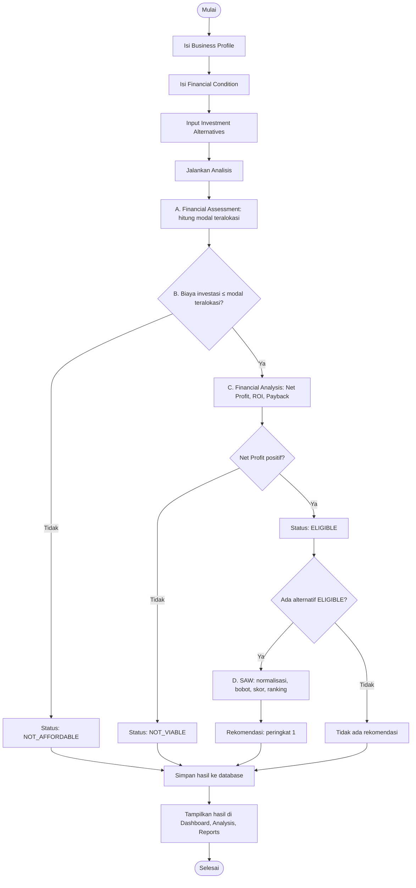
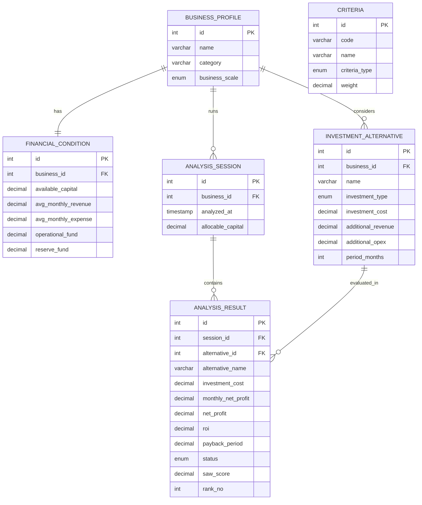
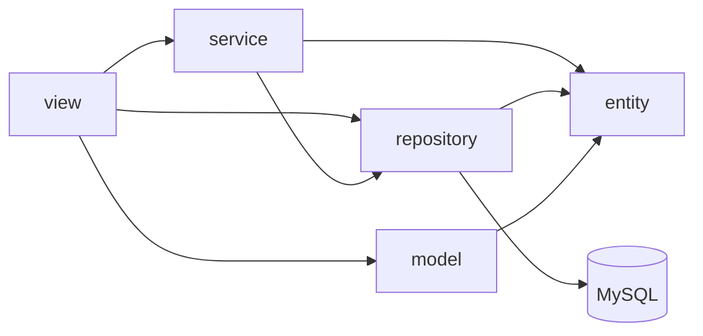
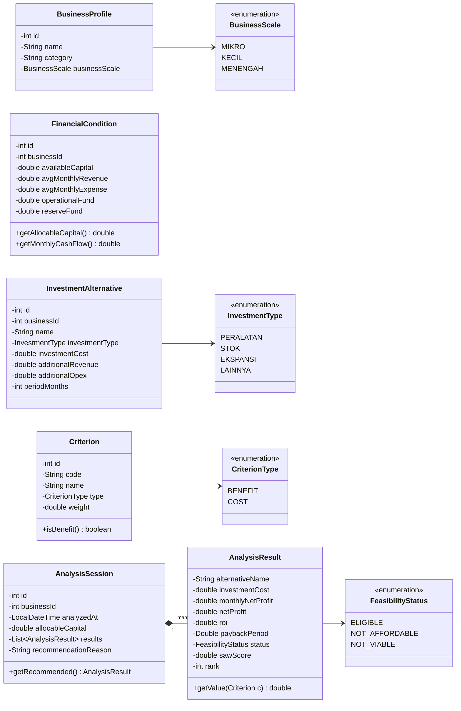
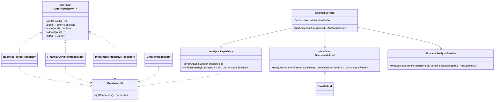
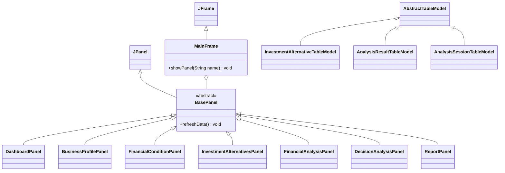

# UMKM Investment Decision Support System

Aplikasi desktop berbasis **Java Swing** yang membantu pemilik Usaha Mikro, Kecil, dan Menengah (UMKM) menentukan **satu prioritas investasi terbaik** dari beberapa alternatif, dengan mempertimbangkan kondisi keuangan, keterbatasan modal, dan potensi keuntungan. Proyek mata kuliah Pemrograman Berorientasi Objek (PBO).

## Daftar Isi

1. [Deskripsi](#1-deskripsi)
2. [Alur dan Fungsionalitas](#2-alur-dan-fungsionalitas)
3. [Rancangan Database](#3-rancangan-database)
4. [Rancangan Class](#4-rancangan-class)
5. [Cara Menjalankan](#5-cara-menjalankan)

---

## 1. Deskripsi

| Komponen | Pilihan |
|---|---|
| Bahasa dan GUI | Java (JDK 17+), Swing |
| Database | MySQL 8, nama database `umkm_investment_dss` |
| Akses data | JDBC (MySQL Connector/J) |
| Metode keputusan | SAW (Simple Additive Weighting) |
| Pengguna | Pemilik UMKM (semua kategori usaha), single user |

**Cakupan investasi:** peralatan, stok, ekspansi, dan lainnya. Semuanya diperlakukan sama karena sistem hanya membutuhkan biaya investasi, tambahan pendapatan, tambahan biaya operasional, dan periode.

**Metode SAW:** tiap alternatif dinilai dengan 4 indikator, dinormalisasi, dikalikan bobot, lalu dijumlahkan menjadi skor. Skor tertinggi menjadi rekomendasi.

| Kode | Indikator | Tipe | Bobot awal |
|---|---|---|---|
| C1 | ROI | Benefit | 0,30 |
| C2 | Net Profit | Benefit | 0,25 |
| C3 | Payback Period | Cost | 0,25 |
| C4 | Investment Cost | Cost | 0,20 |

---

## 2. Alur dan Fungsionalitas

### 2.1 Input, Proses, dan Output

| Tahap | Isi |
|---|---|
| **Input** | Profil usaha (nama, kategori, skala); kondisi keuangan (modal tersedia, pendapatan bulanan, pengeluaran operasional bulanan, dana operasional, dana cadangan); alternatif investasi (nama, jenis, biaya, tambahan pendapatan per bulan, tambahan biaya operasional per bulan, periode dalam bulan) |
| **Proses** | **A.** Financial Assessment: hitung modal teralokasi (modal tersedia − dana operasional − dana cadangan). **B.** Feasibility Check: biaya investasi harus ≤ modal teralokasi. **C.** Financial Analysis: hitung Net Profit, ROI, dan Payback Period. **D.** Decision Making: ranking dengan SAW |
| **Output** | Financial Overview, Feasibility Report, Investment Comparison (ROI, Net Profit, Payback, skor), dan satu Investment Recommendation beserta alasannya |

Status setiap alternatif setelah dianalisis:

| Status | Arti | Ikut ranking? |
|---|---|---|
| `ELIGIBLE` | Terjangkau dan menguntungkan | Ya |
| `NOT_AFFORDABLE` | Biaya melebihi modal teralokasi | Tidak |
| `NOT_VIABLE` | Net Profit ≤ 0 | Tidak |

### 2.2 Alur Proses



### 2.3 Menu Aplikasi

Aplikasi memakai satu `MainFrame` dengan menu samping (sidebar) dan area konten berbasis `CardLayout`.

| Menu | Fungsi |
|---|---|
| Dashboard | Ringkasan keuangan, jumlah alternatif, dan rekomendasi terakhir |
| Business Profile | Mengelola profil UMKM |
| Financial Condition | Memasukkan data keuangan; modal teralokasi tampil otomatis |
| Investment Alternatives | Tambah, ubah, hapus, dan lihat alternatif investasi |
| Financial Analysis | Menampilkan Net Profit, ROI, Payback Period, dan status kelayakan |
| Decision Analysis | Menjalankan analisis; menampilkan skor, ranking, dan rekomendasi |
| Reports | Hasil analisis terakhir dan riwayat analisis |

---

## 3. Rancangan Database

**Database:** `umkm_investment_dss` (MySQL). Skrip pembuatan tabel berada di `src/main/resources/script.sql`.



| Tabel | Fungsi |
|---|---|
| `business_profile` | Profil UMKM |
| `financial_condition` | Kondisi keuangan UMKM (relasi 1:1 dengan profil) |
| `investment_alternative` | Alternatif investasi yang dipertimbangkan |
| `criteria` | Master 4 indikator SAW: tipe (benefit/cost) dan bobot |
| `analysis_session` | Satu kali eksekusi analisis (riwayat) |
| `analysis_result` | Hasil tiap alternatif pada satu sesi analisis; menyimpan salinan nilai agar riwayat tetap utuh walau alternatif diubah atau dihapus |

---

## 4. Rancangan Class

### 4.1 Struktur Proyek

```
src/main/
├── java/com/github/umkminvestmentdss/
│   ├── Main.java
│   ├── entity/        BusinessProfile, FinancialCondition, InvestmentAlternative,
│   │                  Criterion, AnalysisSession, AnalysisResult
│   │                  + enum: BusinessScale, InvestmentType, CriterionType, FeasibilityStatus
│   ├── model/         InvestmentAlternativeTableModel, AnalysisResultTableModel,
│   │                  AnalysisSessionTableModel
│   ├── repository/    DatabaseUtil, CrudRepository, BusinessProfileRepository,
│   │                  FinancialConditionRepository, InvestmentAlternativeRepository,
│   │                  CriterionRepository, AnalysisRepository
│   ├── service/       AnalysisService, FinancialAnalysisService, DecisionMethod, SawMethod
│   └── view/          MainFrame, BasePanel, DashboardPanel, BusinessProfilePanel,
│                      FinancialConditionPanel, InvestmentAlternativesPanel,
│                      FinancialAnalysisPanel, DecisionAnalysisPanel, ReportPanel
└── resources/
    └── script.sql
```

| Paket | Peran |
|---|---|
| `entity` | Data yang dipetakan ke tabel, beserta enum |
| `model` | `TableModel` yang menghubungkan data dengan `JTable` |
| `repository` | Akses database dengan JDBC |
| `service` | Logika analisis finansial dan SAW |
| `view` | Antarmuka Swing, tanpa rumus |



CRUD sederhana dilakukan `view` → `repository`. Proses analisis dilakukan `view` → `AnalysisService` → `repository`.

### 4.2 Diagram Class: Entity



### 4.3 Diagram Class: Repository dan Service



| Class | Tanggung jawab |
|---|---|
| `FinancialAnalysisService` | Tahap B dan C untuk satu alternatif: status kelayakan, Net Profit, ROI, Payback Period |
| `SawMethod` | Tahap D: normalisasi, skor, dan ranking |
| `AnalysisService` | Mengorkestrasi tahap A sampai D, menyusun alasan rekomendasi, dan menyimpan hasil |

### 4.4 Diagram Class: View dan Model



### 4.5 Penerapan OOP

| Konsep | Penerapan |
|---|---|
| **Encapsulation** | Atribut `entity` bersifat `private` dengan getter dan setter; validasi dasar ada di setter; perhitungan turunan seperti modal teralokasi dibungkus di `FinancialCondition` |
| **Inheritance** | `MainFrame` mewarisi `JFrame`; tujuh panel mewarisi `BasePanel` (turunan `JPanel`); tiga TableModel mewarisi `AbstractTableModel` |
| **Abstraction** | `BasePanel` (abstract class), interface `CrudRepository<T>`, dan interface `DecisionMethod` |
| **Polymorphism** | `MainFrame` memanggil `refreshData()` pada tipe `BasePanel` dan tiap panel menjalankan versinya sendiri; `AnalysisService` menerima `DecisionMethod` (`new AnalysisService(new SawMethod())`); TableModel meng-*override* `getValueAt()` dan `getColumnCount()` |

---

## 5. Cara Menjalankan

1. Pastikan JDK 17+ dan MySQL 8 sudah terpasang.
2. Jalankan `src/main/resources/script.sql` pada MySQL untuk membuat database, tabel, dan data indikator awal.
3. Sesuaikan `URL`, `USERNAME`, dan `PASSWORD` di `repository/DatabaseUtil.java`.
4. Tambahkan MySQL Connector/J ke classpath proyek.
5. Jalankan `Main.java`.